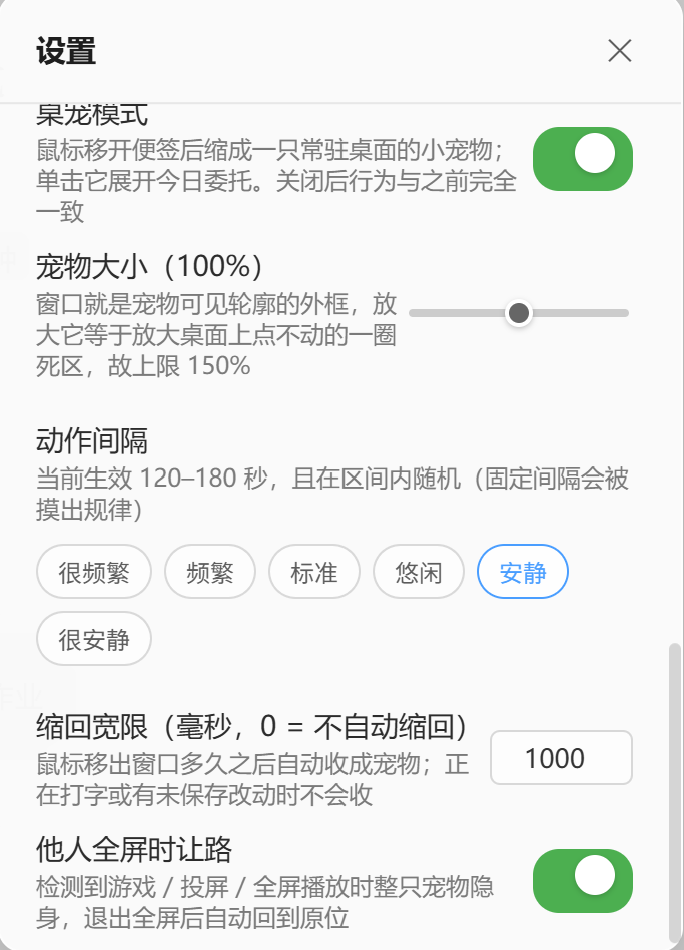

# 每日委托模拟器 (Daily Commissions Simulator)

<p align="center">
  
</p>

<p align="center">
  一个基于 <strong>Tauri 2 + React 19 + Milkdown</strong> 构建的 Windows 半透明 Markdown 便签应用。
</p>

<p align="center">
  
  
  
  
  
</p>

> 🎯 绿色免安装，约 18MB，轻量常驻桌面，还能是一只桌宠。

---

## 目录

- [产品亮点](#产品亮点)
- [功能特性](#功能特性)
- [安装](#安装)
- [使用指南](#使用指南)
- [快捷键](#快捷键)
- [截图展示](#截图展示)
- [技术栈](#技术栈)
- [数据存储](#数据存储)
- [开发](#开发)
- [项目结构](#项目结构)
- [常见问题](#常见问题)
- [路线图](#路线图)
- [更新日志](#更新日志)
- [贡献指南](#贡献指南)
- [License](#license)

---

## 产品亮点

| 亮点              | 说明                                                                     |
| ----------------- | ------------------------------------------------------------------------ |
| 🪶 极致轻量       | 绿色版仅约 18MB，无需安装即可运行，无额外运行时依赖。                    |
| 📝 Markdown 原生  | 采用 Milkdown Crepe WYSIWYG 编辑器，内容即为标准 Markdown。              |
| 🎯 每日委托       | 每天自动新建一份「每日委托」，智能继承前一天未完成事项。                 |
| 🪨 原石激励       | 完成委托可累积「原石」，将每日任务变成看得见的积累。                     |
| 🏆 砺行修远       | 每周挑战：≥5 天三全完成委托，获得成倍原石奖励。                          |
| 🐾 桌宠形态       | 同一个窗口两种形态：鼠标移开便签就缩成一只桌面小宠物，单击展开今日委托。 |
| 🎨 半透明 Acrylic | 支持 25%~100% 透明度调节，工作时可见但不遮挡。                           |
| 🖼️ 自定义皮肤     | 可导入图片作为整窗背景，让便签更个性化。                                 |

---

## 功能特性

### 📝 Markdown 编辑

所见即所得 (WYSIWYG) 编辑器，支持常用 Markdown 语法：

- 标题 `# ~ ######`、粗体 `**text**`、斜体 `*text*`
- 有序列表、无序列表、任务列表 `- [ ]` / `- [x]`
- 代码块、行内代码、引用块、分隔线
- 表格、链接、图片
- 点击任务列表方框即可标记完成 ✅

### 🎯 每日委托

每天打开应用时自动创建一份「每日委托」（若当天已有则不会重复创建），包含四个模块：

| 模块      | 说明                                                 |
| --------- | ---------------------------------------------------- |
| 必做      | 每天必须完成的事项，新委托会**全部继承**前一天内容   |
| 学习/工作 | 学习与工作任务，新委托只继承**未完成**的项           |
| 生活/其他 | 生活杂项，新委托只继承**未完成**的项                 |
| 随手小记  | 自由记录区，**不继承**、每天空白，随手记下想法与灵感 |

### 🪨 原石奖励（每日结算）

打开应用时会自动**结算最近一份尚未结算的每日委托**：

- **必做 / 学习·工作 / 生活·其他** 每一项须**至少有一条非空委托**且这些委托**全部勾选**，才算该模块完成（空模块 / 仅含空白项视为未完成，需填上实际任务才能计入达标）
- 每完成一项 → **+10 原石**
- 三项全部完成 → 额外 **+20 原石**（即三项全完成共 **+50**）
- 原石余额累加，永久保留

### 🏆 砺行修远（周挑战）

标题栏「砺行修远」按钮，点击查看并结算**本周（周一至今日）**的委托完成进度：

- 本周内有 **≥5 天** 三项全部完成 → 获得 **100 × 连续达标周数** 原石
- 连续达标第 1 周 +100、第 2 周 +200 …… 第 7 周 +700 后清零
- 中断（某周未达标）→ 连续周数清零；**周中查看进度不会提前清零**，只有进入下一周且上一周未达标时才会中断
- 弹窗会展示本周每天的完成情况

### 🐾 桌宠形态

- **单窗两态**：便签与桌宠是同一个窗口的两种形态，编辑器不会重载；鼠标移开便签若干毫秒后自动收成宠物，单击宠物展开今日委托
- **开启方式**：托盘菜单「桌宠模式：开/关」，或设置 → 桌宠 → 桌宠模式；关闭后应用行为与桌宠化之前完全一致
- **透明动画**：12 段带 alpha 的 VP9 WebM（约 4.8MB 内嵌进 exe，无需任何运行时依赖），播放时窗口等于宠物可见轮廓，四周不留点不动的透明死区
- **它会看你的数据**：勾掉一条委托就掉金袋，晚上 21–22 点还没做完会垂头叹气，「学习/工作」「生活/其他」都空着会气泡提醒并心虚偷吃零食；超过 5 分钟没人点、没人拖会自己打招呼，深夜小憩、清晨刷牙、工作时间写字
- **说话的分寸**：气泡画在独立的透明小窗里逐字浮现，且只在主人空闲 8 秒~10 分钟之间开口；正在打字或窗口收起时不会说
- **让路全屏**：检测到游戏 / 投屏 / 全屏播放时整只宠物隐身，退出后回到原位（设置中可关）
- **没有边框，也不给拉**：宠物态窗口无可见边框与投影，并锁定为不可拉伸——尺寸只在设置里调（50%~150%），免得一拉就把桌面上「点不动」的透明区一起拉大
- **分寸感**：叹气、哼歌、写字、刷牙这类一次性动作演完就回到常驻呼吸，不会首尾相接循环；「安静 / 很安静」两档下常驻呼吸还会慢放一倍
- **可拖可贴边**：任意拖放，靠近屏幕边缘自动吸附；位置、大小、形态都记住，重启后回到原样

### 🪟 窗口控制

| 按钮 | 功能                                           |
| ---- | ---------------------------------------------- |
| 🎚️   | 透明度滑块（25%~100%），失焦状态下可见但不遮挡 |
| ⚙    | 打开设置面板                                   |
| ─    | 最小化到任务栏                                 |
| ✕    | 关闭并退出程序（不再询问，也不驻留托盘）       |

### 🌓 外观

- **颜色主题**：默认亮色、天空蓝、樱花粉、护眼绿四种浅色底主题，均为深色文字不影响阅读，设置中可预览切换
- **自定义皮肤**：在设置中导入图片作为整窗背景，各颜色主题下均可用

### 🔧 其他

- **委托列表**：侧边栏按日期倒序展示每日委托，点击切换，双击标题重命名
- **右键菜单**：重命名 / 删除委托
- **系统托盘**：应用运行期间常驻托盘，左键唤出窗口（此前被最小化或收进托盘也叫得回来），右键菜单（显示窗口 / 桌宠模式 / 开机自启 / 退出）；点标题栏的 ✕ 是直接退出，不再后台常驻
- **开机自启动**：设置中开启，登录后自动启动并直接显示窗口
- **位置记忆**：自动保存窗口位置和大小，重启恢复
- **自动保存**：编辑后 500ms 自动保存，无需手动操作

---

## 安装

### 🟢 绿色版（推荐）

下载 `Daily_Commissions_Simulator_0.2.6_x64-portable.exe`，放到任意目录，双击运行。

无需安装、无卸载残留。搬家或分享直接复制这一个文件即可。

### 📦 安装版

运行 `Daily_Commissions_Simulator_0.2.6_x64-setup.exe`，按提示完成安装。

- 默认路径：`%LOCALAPPDATA%\Programs\` 下的应用目录
- 自动创建桌面和开始菜单快捷方式
- 在「设置 → 应用」中可正常卸载

### 系统要求

- Windows 10 1803+ 或 Windows 11
- 64 位系统
- 无需额外安装运行时（系统内置 WebView2）

---

## 使用指南

### 每日委托

1. 每天首次打开应用，自动创建当天「每日委托」（标题如 `0816`）
2. 在各模块中填入待办事项，完成打勾 `- [x]`
3. 全部内容自动保存
4. 侧边栏点击可切换历史委托；双击标题可重命名

### 获取原石

把每天委托中三个模块（必做 / 学习·工作 / 生活·其他）的任务**全部勾选**。第二天打开应用时自动结算：

- 完成 1 项 +10、2 项 +20、3 项全完成 +50 原石

### 砺行修远周挑战

1. 点击标题栏「砺行修远」
2. 查看本周（周一~今日）每天是否三全完成
3. 若本周 ≥5 天三全完成 → 自动奖励 `100 × 连续达标周数` 原石
4. 连续 7 周后清零重新开始；中断则清零

### 任务列表

在编辑器中输入 `- [ ] 任务描述` 创建一个待办项。点击方框即可在「未完成 / 已完成」之间切换：

```markdown
- [ ] 未完成的任务
- [x] 已完成的任务
```

---

## 快捷键

> 以下为默认快捷键映射；快捷键自定义在路线图中：

| 快捷键                  | 功能                        |
| ----------------------- | --------------------------- |
| `Ctrl + ,`              | 打开设置                    |
| `Ctrl + =` / `Ctrl + -` | 增加 / 降低窗口透明度       |
| `Ctrl + Shift + P`      | 便签 ⇄ 桌宠（仅便签态有效） |
| `Alt + F4`              | 关闭窗口                    |

> 桌宠态的窗口不抢键盘焦点（否则会把焦点从你正在打字的别处抢走），因此**宠物态收不到任何快捷键**：想展开便签就单击宠物、或用托盘菜单。

---

## 截图展示

| 主界面                               | 每日委托                                 | 明日委托                                 |
| ------------------------------------ | ---------------------------------------- | ---------------------------------------- |
|  |  |  |

| 设置 · 颜色主题                            | 天空蓝                                    | 樱花粉                                    | 护眼绿                                    |
| ------------------------------------------ | ----------------------------------------- | ----------------------------------------- | ----------------------------------------- |
|  |  |  |  |

| 砺行修远                                 | 检查更新                                 |
| ---------------------------------------- | ---------------------------------------- |
|  |  |

| 桌宠 · 宠物态                             | 桌宠 · 说话                               | 设置 · 桌宠                                |
| ----------------------------------------- | ----------------------------------------- | ------------------------------------------ |
|  |  |  |

> 截图与《使用说明》共用 `docs/assets/`，界面随版本迭代可能略有差异。

---

## 技术栈

| 层级     | 技术                         |
| -------- | ---------------------------- |
| 桌面框架 | Tauri 2 (Rust)               |
| 前端     | React 19 + TypeScript        |
| 构建工具 | Vite 6                       |
| 编辑器   | Milkdown Crepe (ProseMirror) |
| 状态管理 | Zustand                      |
| 样式     | 纯 CSS（无框架依赖）         |
| 打包     | NSIS / 绿色免安装            |

---

## 数据存储

所有数据存储在本地，不上传任何信息：

```text
%APPDATA%\com.liurr.lightweight-sticky-notes\
├── config.json               # 应用配置（透明度、原石、砺行周数）
├── notes_index.json          # 委托索引（含结算状态）
├── notes\
│   └── <uuid>.md             # 委托内容（标准 Markdown 格式）
```

备份数据只需复制整个文件夹。委托内容为标准 `.md` 文件，可用任意 Markdown 编辑器打开。

---

## 开发

### 环境准备

- [Node.js](https://nodejs.org/) >= 18
- [Rust](https://www.rust-lang.org/)（通过 `rustup` 安装）
- Windows 系统需要 MSVC 构建工具（`winget install Microsoft.VisualStudio.2022.BuildTools`）

### 克隆与运行

```bash
git clone https://github.com/HonestLeon/Daily-Commissions-Simulator.git
cd Daily-Commissions-Simulator
npm install
npm run tauri dev
```

### 构建

```bash
npm run tauri build
```

产物：

- 绿色版：`src-tauri/target/release/lightweight-sticky-notes.exe`
- 安装版：`src-tauri/target/release/bundle/nsis/每日委托模拟器_0.2.6_x64-setup.exe`

### 开发脚本

```bash
npm run dev        # 单独启动前端 Vite 开发服务器
npm run build      # 构建前端产物
npm run preview    # 预览前端产物
npm run tauri dev  # 启动 Tauri 开发模式
```

---

## 项目结构

```text
lightweight-sticky-notes/
├── src/                          # React 前端
│   ├── assets/                   # 图标资源
│   │   ├── app-icon.png
│   │   ├── lixing.png            # 砺行修远图标
│   │   ├── yuan-shi-16.png
│   │   ├── yuan-shi.png          # 原石图标
│   │   └── pet/                  # 桌宠 α-WebM 素材 + 动作清单 pet_actions.json
│   ├── components/
│   │   ├── TitleBar.tsx          # 标题栏（原石余额、砺行修远、透明度、最小/关闭）
│   │   ├── Sidebar.tsx           # 委托列表（切换、重命名、右键菜单）
│   │   ├── NoteEditor.tsx        # Milkdown Crepe 编辑器封装
│   │   ├── SettingsPanel.tsx     # 设置（自启、透明度、皮肤、桌宠）
│   │   ├── PetStage.tsx          # 桌宠态画面（双缓冲 <video> + 动作调度 + 单击/拖拽阈值）
│   │   ├── PetBubble.tsx         # 气泡窗（独立透明小窗，逐字显示）
│   │   ├── petAnimations.ts      # 动作池 / 权重 / 门控挑选
│   │   ├── UpdateDialog.tsx      # 检查更新弹窗
│   │   ├── LixingDialog.tsx      # 砺行修远结算弹窗
│   │   └── tomorrowCheck.ts      # 「明日委托」解析工具
│   ├── stores/
│   │   └── noteStore.ts          # Zustand 全局状态
│   ├── types/
│   │   └── index.ts              # TypeScript 类型定义
│   ├── App.tsx                   # 根布局
│   ├── App.css                   # 全局样式（含皮肤与透明度）
│   ├── main.tsx                  # 入口
│   └── vite-env.d.ts
├── src-tauri/                    # Rust 后端
│   ├── src/
│   │   ├── main.rs               # 进程入口
│   │   └── lib.rs                # 命令定义、委托结算、砺行修远、自更新、托盘、Acrylic、桌宠几何与门控
│   ├── capabilities/
│   │   └── default.json          # 权限声明（main + bubble 两个窗口）
│   ├── icons/                    # 应用图标
│   ├── tauri.conf.json           # Tauri 配置（含 bubble 气泡窗声明）
│   └── Cargo.toml
├── dist/                         # 前端构建产物（build 时生成）
├── releases/                     # 安装版发布包
├── index.html
├── package.json
├── vite.config.ts
└── tsconfig.json
```

---

## 常见问题

### Q1：为什么绿色版首次启动较慢？

Windows Defender 等杀毒软件会对首次运行的 exe 进行扫描，这是正常现象。后续启动会更快。

### Q2：如何备份我的委托和原石？

复制 `%APPDATA%\com.liurr.lightweight-sticky-notes\` 整个文件夹到安全位置即可。重装系统或换电脑后粘贴回原路径即可恢复（原石余额在 `config.json` 中）。

### Q3：能否在 macOS / Linux 上运行？

当前版本主要针对 Windows 打包与测试。Tauri 2 本身支持跨平台，源码具备跨平台潜力，欢迎提交 PR 扩展构建流程。

### Q4：如何彻底卸载？

- 绿色版：直接删除 exe 与数据文件夹即可。
- 安装版：在「设置 → 应用」中卸载，数据文件夹需手动删除。

### Q5：任务列表的勾选状态不同步？

请确保点击的是编辑器渲染出的任务列表复选框。若仍有问题，可尝试切换委托后重新进入。

### Q6：为什么没有结算到原石？

- 委托必须**跨天**后才会结算（当天创建的委托在第二天打开应用时结算）。
- 只有「必做 / 学习·工作 / 生活·其他」三个模块参与结算，需全部勾选才算完成。

### Q7：鼠标移出便签，为什么她没缩成宠物？

光标还停在正文里时，她会以为你正在打字，于是拒绝收起——这是「不打断输入」的规矩。点一下标题栏或侧边栏让编辑器失焦后再移开鼠标，或者直接按 `Ctrl + Shift + P`。有未保存的编辑时同样不会收。

### Q8：桌宠能用鼠标拉着边框放大吗？

不能。宠物态窗口无边框、无投影，也被锁成不可拉伸：窗口就是宠物可见轮廓的外框，用边框一拉就等于把桌面上「点不动」的透明区一起拉大。要变大变小请去「设置 → 桌宠 → 宠物大小」（50%~150%）。切回便签态后窗口照常可自由拉伸。

---

## 路线图

- [x] Markdown WYSIWYG 编辑
- [x] 每日委托 + 智能继承
- [x] 原石结算奖励
- [x] 砺行修远周挑战
- [x] 透明度、自定义皮肤
- [x] 系统托盘与开机自启
- [x] 自动保存与窗口位置记忆
- [x] 快捷键绑定（Ctrl/,、Ctrl+=/-、Shift+P）
- [x] 检查更新（GitHub Release 自动更新）
- [ ] 快捷键自定义
- [ ] 云同步 / WebDAV 备份
- [ ] 委托标签
- [ ] 原石统计图表
- [ ] 插件扩展机制

---

## 更新日志

### v0.2.6（2026-10-23）

- 便签态固定为普通窗口：移除「始终置顶」「闹钟模式」两个模式与 `Ctrl + Shift + T`，标题栏不再有模式按钮；桌宠态在不隐藏时仍恒置顶
- 关闭一律退出：删除「最小化到托盘」设置与首次关闭询问；开机自启后直接显示窗口
- 每日委托可靠跨日：窗口连开数天会自动结算昨天、创建今天；结算与继承改按委托创建日期判定，编辑旧便签不再影响「昨天」是谁
- 「砺行修远」连击修正：周中查看不再提前清零，只有上一自然周确实没达标才中断
- 继承更完整：一个任务连同缩进续行、嵌套子项整块带走；代码块里的示例不再被当成委托统计
- 桌宠金袋改为事件驱动：「勾掉一条委托 → 缩回宠物」必定演一次金袋，不再被请安顶掉（含开发模式下只演请安的修复）
- 拖便签边框调整大小时不再被误判成「鼠标移开」而缩成宠物
- 保存更稳：切换便签先把上一张落盘、失败 5 秒后重试；索引与委托文件原子写入并保留备份，索引损坏时从 `.md` 重建
- 多显示器 / 混合缩放下恢复窗口位置不再跳回主屏
- 编辑器：单击本地文件链接用系统默认程序打开，http(s) 链接交给浏览器，相对链接不再让窗口跳走
- 检查更新与标题栏应用图标的链接迁至 GitHub（仓库 `HonestLeon/Daily-Commissions-Simulator`）
- 其它：设置面板 / 更新弹窗打开时不再自动缩回宠物；全屏检测不再把普通最大化窗口当成他人全屏

### v0.2.5（2026-10-20）

- 新增「桌宠形态」：便签与桌宠共用一个窗口，鼠标移开便签自动缩成一只常驻桌面的小宠物（12 段透明 VP9 WebM 动画），单击展开今日委托，可任意拖放并贴边吸附；托盘菜单与设置面板各有开关，关闭后行为与之前完全一致
- 宠物会看当天数据表演：三模块完成度、刚结算、明日委托是否填写、当前时段都参与动作挑选；气泡在独立的透明小窗里逐字浮现，只在主人空闲 8 秒~10 分钟之间开口
- 他人全屏（游戏 / 投屏 / 全屏播放）时桌宠自动让路，退出后回原位；窗口隐藏到托盘时停止解码
- 设置面板新增「桌宠」分区：开关、大小（50%~150%）、动作间隔六档、缩回宽限、全屏避让
- 桌宠态窗口没有可见边框与投影，并锁定为不可拉伸（尺寸只在设置里调）；叹气、哼歌、写字这类一次性动作播完回到常驻呼吸而不循环，「安静 / 很安静」两档下常驻呼吸再慢放一倍
- 按住标题栏拖动便签不会被误判成「鼠标移开」而缩成宠物；便签态右侧垂直滚动条恢复，内容超出一屏可上下滚动
- 托盘唤回补上「最小化」这一路：窗口先前是被最小化的，单击托盘图标或托盘「显示窗口」一样能叫回来（闹钟模式的自动弹出同一条路径）
- 快捷键 `Ctrl + Shift + P` 切换便签 ⇄ 桌宠（宠物态不抢键盘焦点，故只在便签态有效）
- 窗口形态与两套几何改为自持（不再依赖 window-state 记尺寸位置）；`config.json` 写入改为原子写并保留上一代备份，中途中断不再损坏配置
- 绿色版体积由约 13MB 增至约 18MB（桌宠素材约 4.8MB 内嵌进 exe，仍是单文件、仍无任何运行时依赖）
- 应用更名为「每日委托模拟器 (Daily Commissions Simulator)」，窗口标题、托盘名称与安装包文件名同步更新；技术标识符（包名、数据目录、仓库地址）保持不变，老用户数据与自更新不受影响
- 编辑器内指向本地文件的链接改为单击用系统默认程序打开（PDF、文档、图片等）
- 标题栏新增「祈愿」按钮占位，功能待实现
- **已知问题**：开着桌宠模式时，拖便签窗口的边框调整大小会被当成「鼠标移开」而缩成宠物，偶尔还会缩成一只便签那么大的宠物——单击它即可展开。下一版修掉

### v0.2.4（2026-09-04）

- 新增「摩拉」币种体系：三个结算模块内已勾选且非空的任务条数 × 100 摩拉，与每日委托一同结算，标题栏显示余额
- 修复从已完成任务项回车后新行错误继承完成状态的 bug，自动补出的待办项均为未完成
- 「明日委托」勾选框收缩到学习/工作、生活/其他模块内显示，与结算/继承模块划分一致

### v0.2.3（2026-08-23）

- 新增 4 种颜色主题（默认 / 天空蓝 / 樱花粉 / 护眼绿）：浅色底、深色字不影响阅读，设置中可预览切换，选择持久化
- 移除暗色模式，应用固定为浅色主题
- 皮肤蒙版颜色随主题色调，皮肤在任意颜色主题下均可用

### v0.2.2（2026-08-23）

- 每日委托结算规则调整：任一模块须至少有一条非空委托且全部勾选，才算该模块完成；空委托不再计入达标与「三全完成」
- UI 优化：统一标题栏 SVG 图标、透明度设置移入设置面板、对比度 token 体系化、面板表面统一、键盘焦点与开关语义、皮肤统一蒙版
- 修复非 Tauri 环境 `getCurrentWindow` 导致的空白页

### v0.2.0（2026-08-16）

- 新增「原石」代币体系：每日委托结算奖励，可累加
- 新增「每日委托」：每天自动创建，智能继承前一天未完成项
- 新增「砺行修远」周挑战：≥5 天三全完成奖励 100× 连续周数原石
- 移除模板机制、Markdown 导入导出、新建便签
- 便签列表改名为委托列表
- 应用图标更换

### v0.1.1（2026-07-12）

- 新增便签搜索（侧边栏按标题实时过滤）
- 新增 Markdown 导入 / 导出（单条导出、批量导出、从 .md 导入）
- 文档与版本号同步

### v0.1.0（2026-06-24）

- 初始版本发布
- 支持 Markdown WYSIWYG 编辑
- 支持多便签、模板系统、每日待办智能继承
- 支持 Acrylic 半透明窗口、置顶、透明度、自定义皮肤
- 支持系统托盘、开机自启、自动保存、窗口位置记忆

---

## 贡献指南

欢迎 Issue 和 PR！在提交代码前，请确保：

1. 代码遵循项目现有 TypeScript / Rust 风格
2. 通过 `npm run build` 成功构建
3. 在 PR 中说明改动目的与影响范围

---

## License

MIT © 2026 HonestLeon
