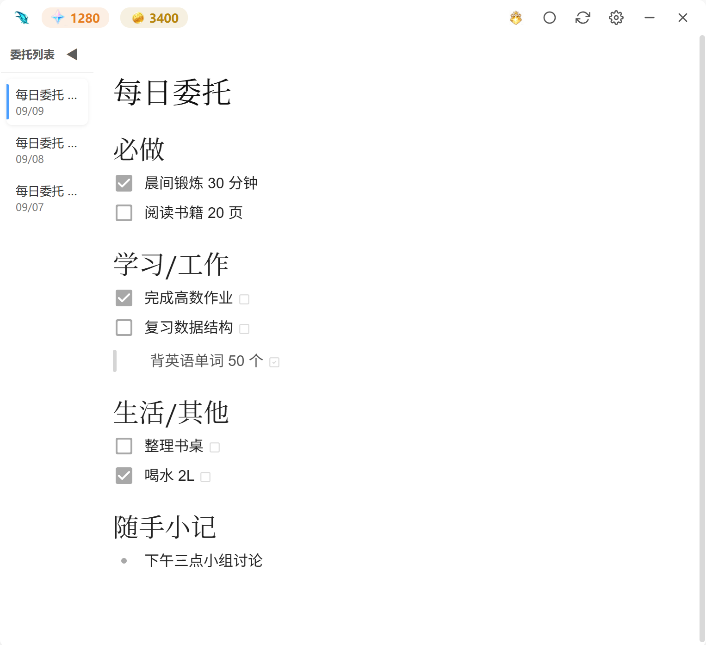
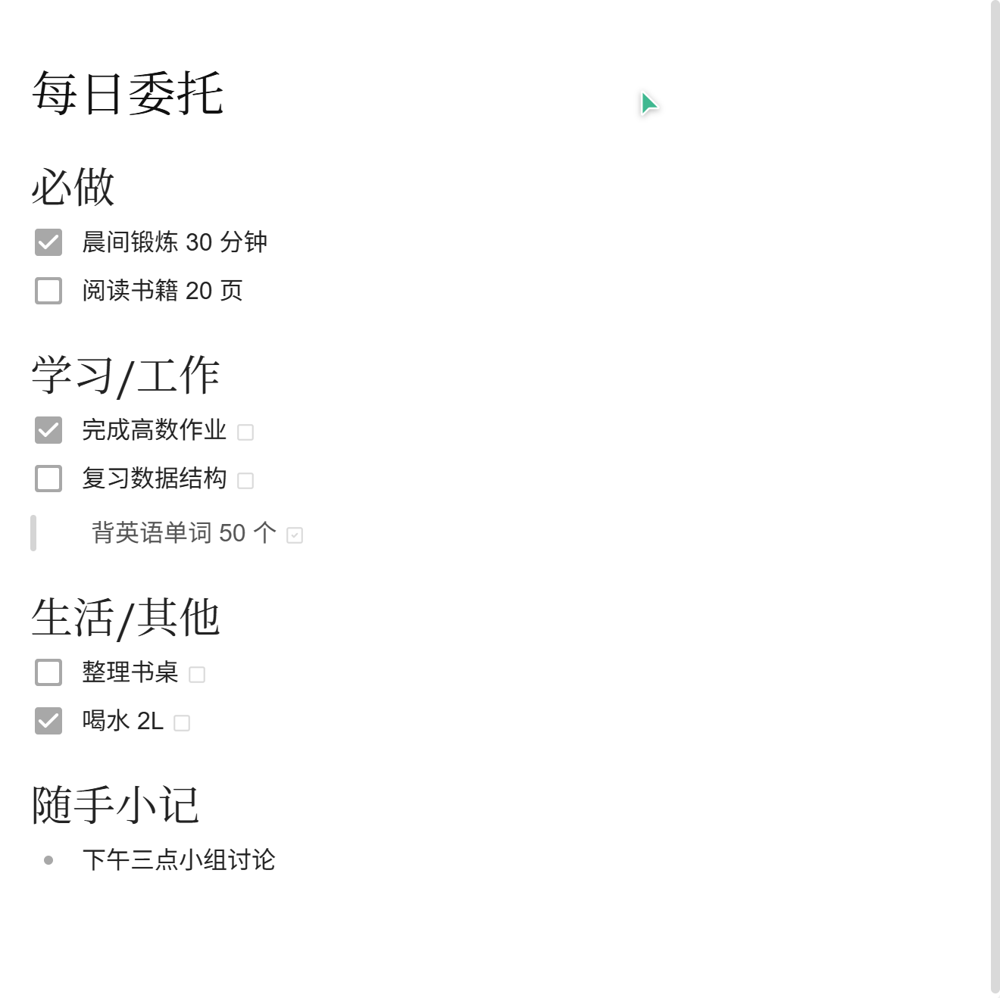
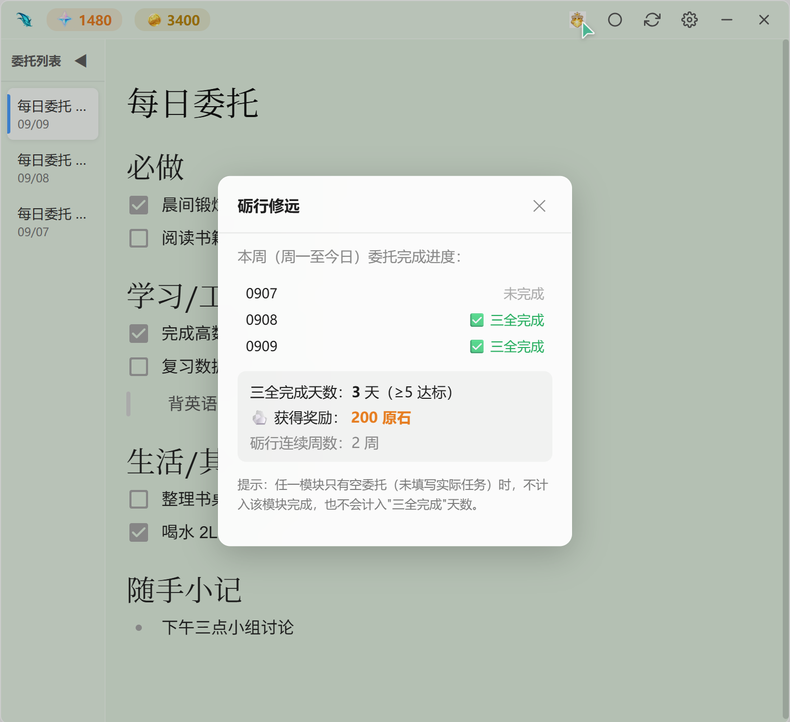
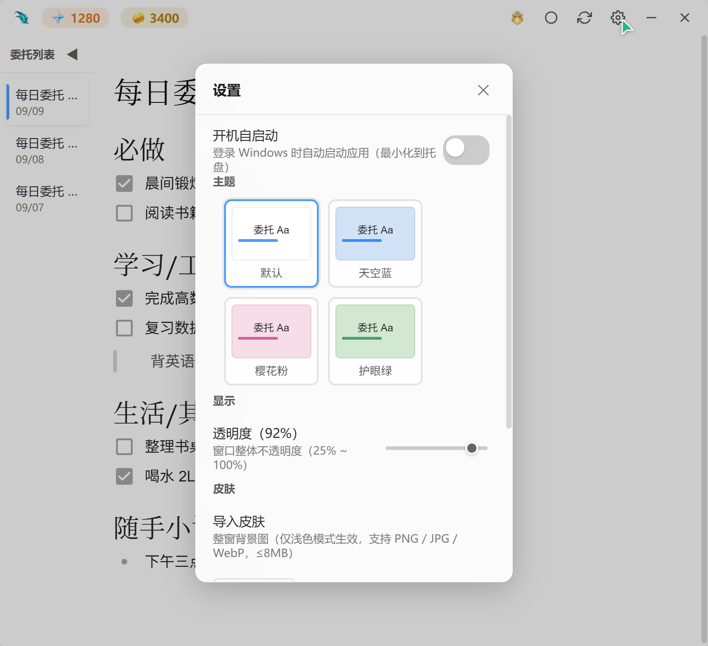
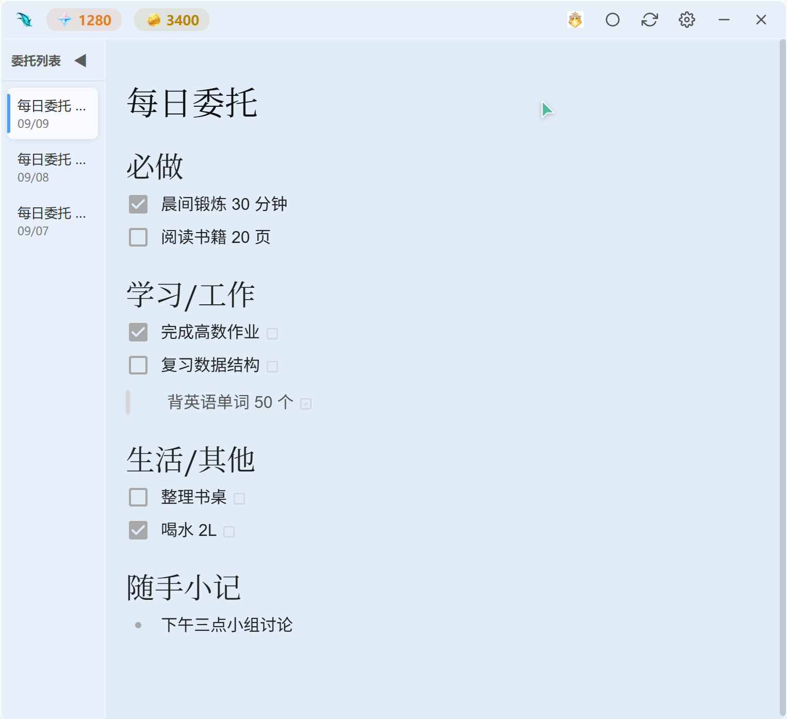
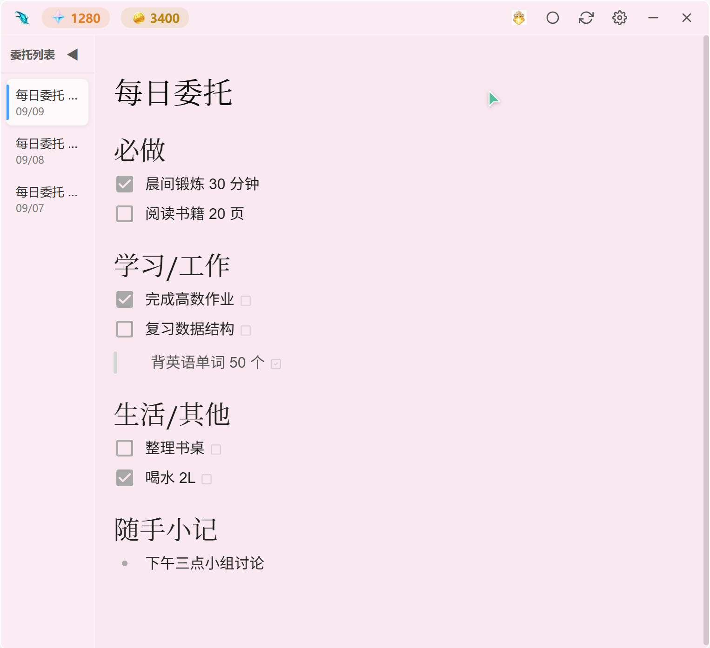
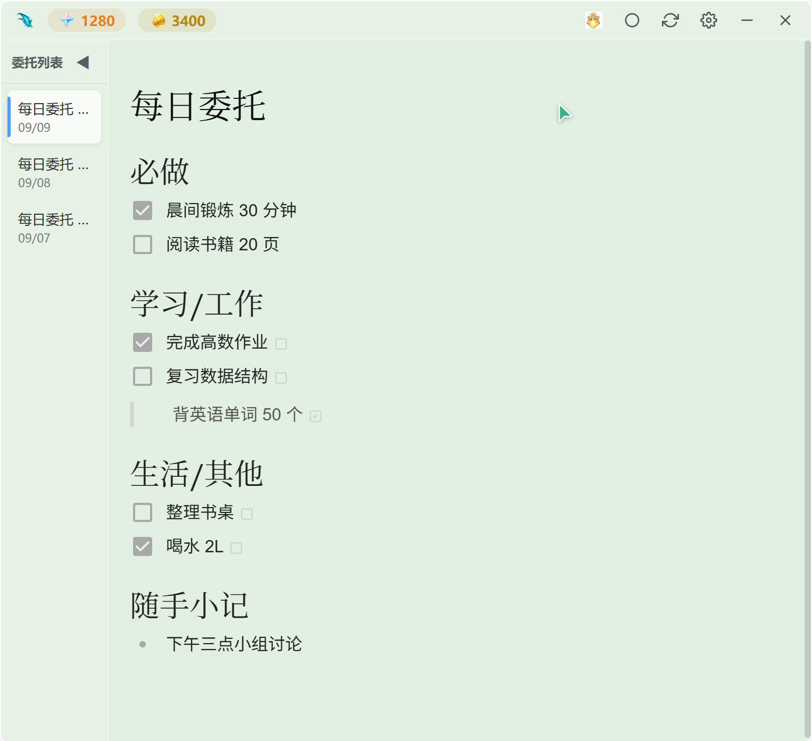
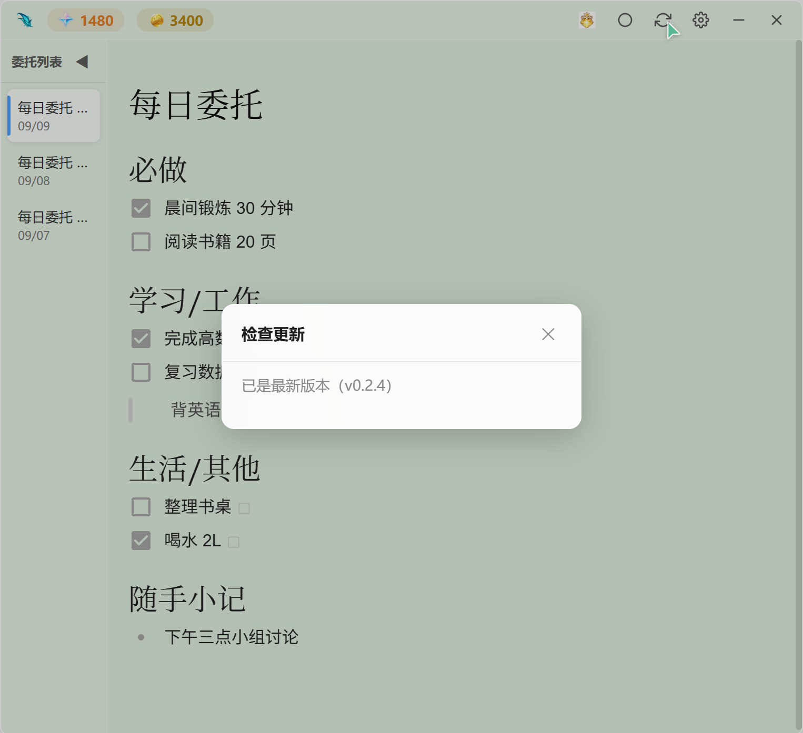

# 每日委托模拟器 · 使用说明

> 一款半透明 Acrylic 材质的 Markdown 桌面便签，用「每日委托 + 原石 + 摩拉」把每天的任务变成看得见的积累。



---

## 1. 安装与启动

发布包内提供两种版本，按需选用其一：

| 版本     | 文件                                    | 适用场景                                               |
| -------- | --------------------------------------- | ------------------------------------------------------ |
| 安装版   | `每日委托模拟器_x.x.x_x64-setup.exe`    | 常规使用。双击安装，支持开机自启与「检查更新」一键升级 |
| 免安装版 | `每日委托模拟器_x.x.x_x64-portable.exe` | 绿色版，单文件即开即用，可放 U 盘随身携带              |

- 安装版：双击 setup.exe，按向导完成安装后从开始菜单或桌面快捷方式启动。
- 免安装版：双击 exe 直接运行，无需任何依赖。
- 首次启动较慢属正常现象（Windows Defender 首次扫描），后续启动会明显加快。

## 2. 界面总览

应用分为三个区域：

- **标题栏**：左侧为应用图标（点击可打开 Gitee 仓库）、原石与摩拉余额；右侧从左到右依次为「砺行修远」「置顶模式」「检查更新」「设置」「最小化」「关闭」按钮。
- **委托列表（侧边栏）**：按日期倒序展示每天的委托便签，点击切换，双击标题可重命名，右键提供重命名 / 删除菜单。
- **编辑区**：所见即所得的 Markdown 编辑器，内容即为标准 Markdown 文本。



## 3. 每日委托

应用每天自动创建一份「每日委托」便签，固定结构为：

| 模块      | 说明                   | 是否参与结算 |
| --------- | ---------------------- | ------------ |
| 必做      | 当天必须完成的核心事项 | 是           |
| 学习/工作 | 学习与工作类任务       | 是           |
| 生活/其他 | 生活琐事与其他安排     | 是           |
| 随手小记  | 自由记录区，不参与结算 | 否           |

**智能继承**：第二天创建新委托时，前一天**未完成**的任务会自动带入今天，已完成的不再出现，无需手动誊抄。

## 4. 明日委托

想为明天预定任务？在「学习/工作」「生活/其他」模块内写下一行任务后，行末会出现「明日委托」勾选小按钮：


勾选后该行变为引用块（`> ` 前缀），当天**不参与结算**；明天创建新委托时，它会自动转为当天的待办任务。

> 提示：勾选框只在光标不在该行内时显示，输入完成后点击其他位置即可看到。

## 5. 原石与摩拉

每日委托在次日首次启动时自动结算，两种货币的规则不同：

| 货币    | 结算规则                                               |
| ------- | ------------------------------------------------------ |
| ⭐ 原石 | 按完成的模块数计：1 个模块 +10，2 个 +20，三全完成 +50 |
| 🪙 摩拉 | 三个结算模块内「已勾选且非空」的任务条数 × 100         |

**模块完成的判定**：该模块内至少有一条非空委托，且所有非空委托全部勾选。空着的委托不算完成——所以请认真填写并做完当天的委托，空的模块得不到任何奖励。

结算后标题栏会弹出土司提示（如「前日委托已结算：+50 原石 +800 摩拉（三全完成）」）。

## 6. 砺行修远（周挑战）

点击标题栏「砺行修远」按钮查看本周战绩：



- **规则**：一个自然周内 ≥ 5 天「三全完成」委托，即达成挑战，获得 100 × 连续周数 的原石奖励。
- 连续达成的周数越多，奖励越高；某周未达标则连续周数清零，但本周仍可补做后再次结算。
- 每个自然周只结算一次，达标发奖后本周即锁定。

## 7. 颜色主题与皮肤

### 颜色主题

打开「设置 → 主题」，提供四种浅色底、深色字的颜色主题，卡片自带效果预览，点击即时切换并自动记忆：



| 主题   | 效果                |
| ------ | ------------------- |
| 默认   | 白色 Acrylic 半透明 |
| 天空蓝 | 淡蓝底色            |
| 樱花粉 | 淡粉底色            |
| 护眼绿 | 淡绿底色            |

三种彩色主题的实际效果：







### 皮肤

设置 → 皮肤 → 「导入 / 更换」，选择一张图片（PNG / JPG / WebP，≤ 8MB）作为整窗背景。皮肤层位于内容之下，蒙版颜色随当前主题色调变化，不影响文字阅读；点「移除皮肤」即可恢复默认背景。

## 8. 窗口控制

### 置顶模式（三态循环）

点击标题栏「置顶」按钮，或使用 `Ctrl + Shift + T`，在三种模式间循环切换：

| 模式     | 表现                                                 |
| -------- | ---------------------------------------------------- |
| 普通模式 | 常规窗口                                             |
| 始终置顶 | 窗口始终保持在其他窗口之上，工作时可见但不遮挡       |
| 闹钟模式 | 每隔设定间隔自动弹出置顶提醒，显示设定时长后自动隐藏 |

### 闹钟模式参数

设置 → 闹钟提醒：

- **提醒间隔**：每隔多少分钟弹出一次（最小 1 分钟）。
- **显示时长**：每次弹出后置顶显示多少秒（最长 60 秒）。
- 首轮提醒在开启后 1 分钟触发；提醒结束后按「关闭行为」设置隐藏到托盘或最小化到任务栏。

### 透明度

设置 → 显示 → 透明度滑块，或使用 `Ctrl + =` / `Ctrl + -` 步进调节（25% ~ 100%），窗口、面板、皮肤整体联动。

## 9. 系统托盘与开机自启

- **关闭行为**：首次点击关闭按钮会弹窗询问「最小化到托盘」或「直接退出」，选择后记住。之后关闭窗口默认进托盘，应用在后台常驻，右键托盘图标可显示 / 退出。
- **开机自启**：设置中开启后，登录 Windows 自动启动并最小化到托盘。

## 10. 自动更新

点击标题栏「检查更新」：



- 应用会查询 Gitee 最新 Release，有新版本时一键下载安装。
- 安装版与免安装版均支持自动更新（免安装版自动完成文件替换，更新期间请勿手动关闭弹出的脚本窗口）。
- 也可前往 [Gitee 发布页](https://gitee.com/Honest_Leon/lightweight-sticky-notes/releases) 手动下载。

## 11. 快捷键

| 快捷键                  | 功能                               |
| ----------------------- | ---------------------------------- |
| `Ctrl + ,`              | 打开设置                           |
| `Ctrl + =` / `Ctrl + -` | 增加 / 降低窗口透明度              |
| `Ctrl + Shift + T`      | 切换置顶模式（普通 → 置顶 → 闹钟） |
| `Alt + F4`              | 关闭窗口（按关闭行为处理）         |

## 12. 编辑器说明

编辑器基于 Milkdown（所见即所得），同时支持标准 Markdown 语法：

- 任务列表：`- [ ] 任务` / `- [x] 已完成`
- 明日委托：`> 任务内容`（引用块）
- 其他：标题 `#`、列表 `-`、加粗 `**`、斜体 `*`、代码、表格等标准语法均可使用
- 内容自动保存（输入后短暂延迟落盘），无需手动保存

## 13. 数据与备份

所有数据仅存储在本地，不上传任何信息：

```
%APPDATA%\com.liurr.lightweight-sticky-notes\
├── config.json          # 配置（原石 / 摩拉 / 主题 / 透明度 / 闹钟参数等）
├── notes_index.json     # 委托索引（含结算状态）
├── notes\<uuid>.md      # 每条委托的 Markdown 原文
└── skins\               # 皮肤图片
```

备份：复制整个上述文件夹到安全位置即可；恢复时粘贴回原路径。

## 14. 常见问题

**Q：绿色版首次启动慢？**
Windows Defender 首次扫描所致，属正常现象，后续启动更快。

**Q：当天什么都没做，会有奖励吗？**
不会。空模块不算完成，原石与摩拉都为 0——这正是督促完成委托的机制。

**Q：明天的任务怎么提前记？**
写在「学习/工作」或「生活/其他」模块下，勾选行末的「明日委托」框即可（见第 4 节）。

**Q：换了电脑怎么迁移？**
备份 `%APPDATA%\com.liurr.lightweight-sticky-notes\` 整个文件夹，在新电脑粘贴回原路径（原石、摩拉与全部委托都会恢复）。

**Q：能在 macOS / Linux 上运行吗？**
当前版本针对 Windows 打包与测试。
